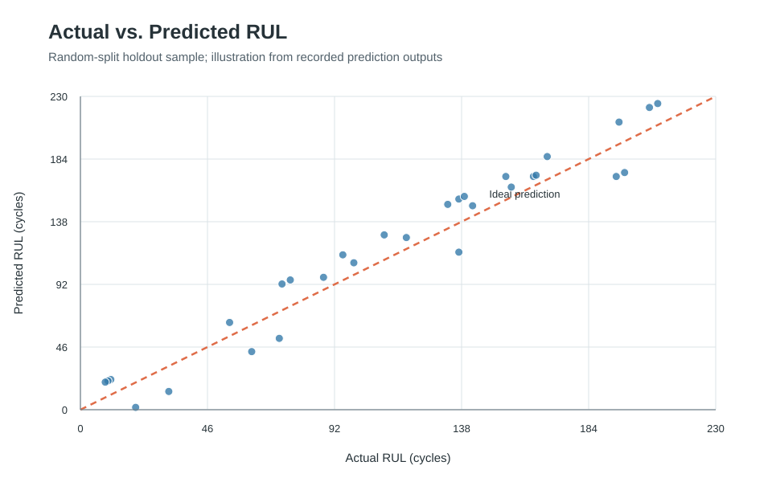
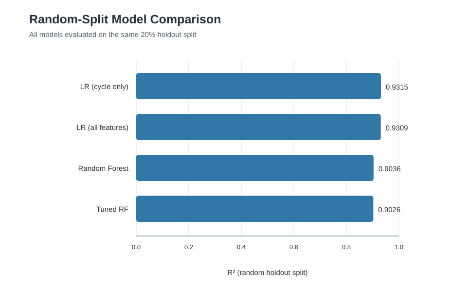
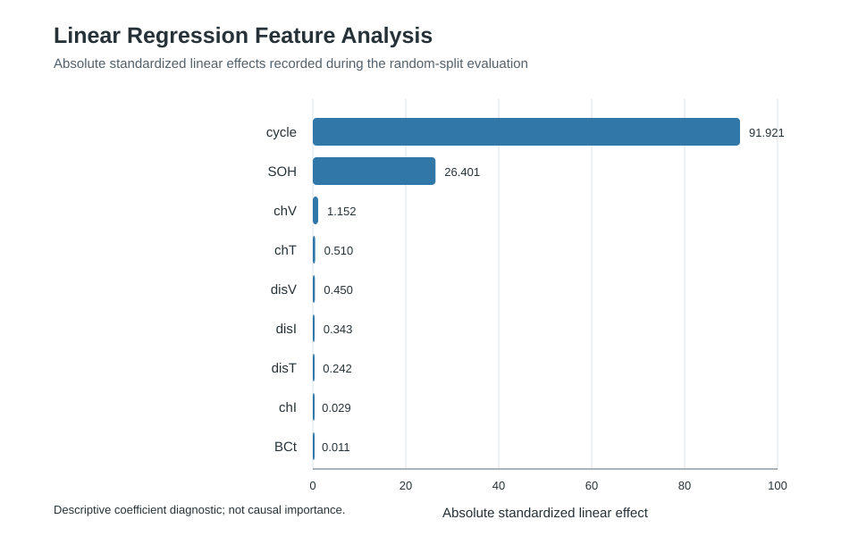
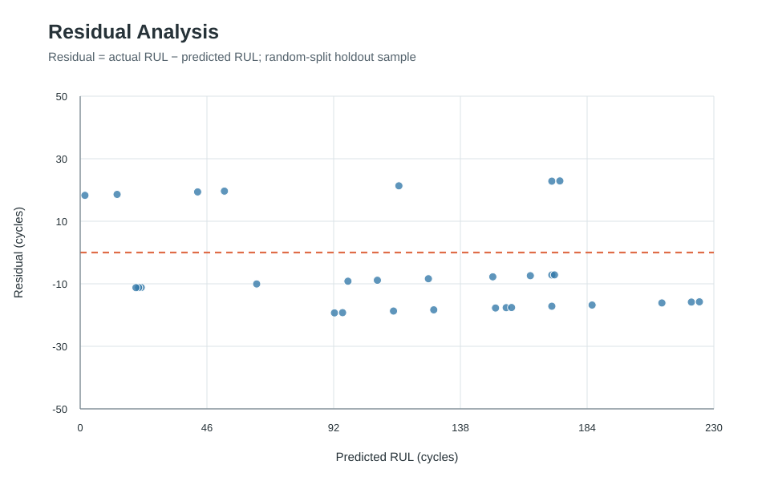
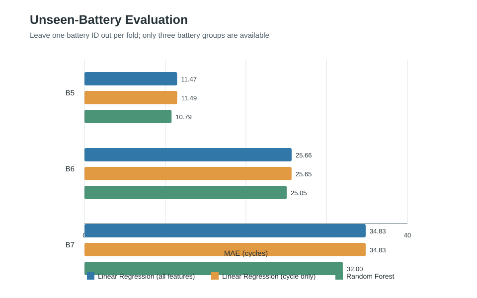

# Battery Health Prediction Using Predictive Analytics

A Python machine-learning project that estimates battery Remaining Useful Life (RUL) from charge/discharge measurements and demonstrates a rule-based battery status recommendation. It compares regression models, evaluates performance on a random holdout split and held-out battery IDs, and saves diagnostic plots.

> **Safety and scope:** This is an academic predictive-analytics prototype. The status thresholds are project-defined demonstration rules, not certified battery safety limits. It is not a validated real-time battery-management or safety system.

## Highlights

- Estimates RUL using nine battery features.
- Compares Linear Regression, Random Forest, and tuned Random Forest.
- Includes a **cycle-only baseline** to test whether other measurements add predictive value.
- Evaluates generalization by leaving one battery ID out at a time.
- Reports MAE, MSE, and R².
- Saves diagnostic plots and CSV evaluation outputs when run.
- Includes an interactive console demonstration.

## Repository structure

```text
battery-health-prediction/
├── README.md
├── requirements.txt
├── .gitignore
├── data/
│   └── DATASET_INSTRUCTIONS.md
├── src/
│   ├── battery_health.py
│   ├── model_evaluation.py
│   └── protection_system.py
├── results/
│   ├── actual_vs_predicted.svg
│   ├── feature_analysis.svg
│   ├── model_comparison.svg
│   ├── residual_analysis.svg
│   ├── unseen_battery_mae.svg
│   └── evaluation CSV files
└── docs/
    └── ACADEMIC_MATERIALS.md
```

The repository includes SVG chart previews for the model comparison, feature analysis, prediction fit, residuals, and held-out-battery MAE. The Python scripts also generate full-resolution PNG plots and detailed row-level leave-one-battery-out predictions when run with the authorized dataset.

## Output charts

**Actual vs. predicted RUL**



**Model comparison**



**Feature analysis**



**Residual analysis**



**Unseen-battery evaluation**



The SVG charts are repository-friendly previews derived from the recorded evaluation metrics and a sample of the saved holdout predictions. They are descriptive model diagnostics, not evidence of certified battery safety.

## Dataset

The supplied project CSV had 680 rows and 11 columns, including `battery_id`, nine input features, and `RUL`. The exact source and redistribution permissions for the transformed CSV have not been independently confirmed, so the raw dataset is intentionally **not included**.

The scripts expect a file at `data/Battery_dataset.csv`. Obtain the dataset from its authorized source, verify that redistribution is allowed, and place the CSV at that path locally. See [`data/DATASET_INSTRUCTIONS.md`](data/DATASET_INSTRUCTIONS.md).

The input features are `cycle`, `chI`, `chV`, `chT`, `disI`, `disV`, `disT`, `BCt`, and `SOH`. Confirm feature meanings and units against the source documentation before making scientific claims.

## Setup

Requires Python 3.10 or later.

```bash
python -m venv .venv
```

Activate the environment:

**Windows**
```powershell
.venv\Scripts\activate
```

**macOS/Linux**
```bash
source .venv/bin/activate
```

Install dependencies:

```bash
python -m pip install -r requirements.txt
```

## Run

After placing the authorized CSV in `data/Battery_dataset.csv`, run from the repository root:

```bash
python src/battery_health.py
python src/model_evaluation.py
```

The first script trains and compares models, saves random-split metrics and plots, then requests sample feature values for a console prediction. The second script evaluates each battery as a held-out group. `battery_id` defines evaluation groups and is not a model input.

## Example random-split results

| Model | MAE | MSE | R² |
|---|---:|---:|---:|
| Linear Regression (cycle only) | 15.049 | 257.646 | 0.9315 |
| Linear Regression (all features) | 15.069 | 259.985 | 0.9309 |
| Random Forest | 17.099 | 362.468 | 0.9036 |
| Tuned Random Forest | 17.098 | 366.344 | 0.9026 |

These random-split metrics are not evidence by themselves of generalization to a new battery. The cycle-only baseline performs similarly to the all-feature linear model in this dataset.

## Held-out battery evaluation

| Held-out battery | Linear Regression (all features) MAE | Cycle-only Linear Regression MAE | Random Forest MAE |
|---|---:|---:|---:|
| B5 | 11.472 | 11.486 | 10.788 |
| B6 | 25.657 | 25.649 | 25.046 |
| B7 | 34.829 | 34.827 | 31.995 |

Only three battery groups are available, too few to support broad generalization claims. Random-split and held-out-battery results answer different questions and should not be compared as if they were the same test.

## Battery status demonstration

| Predicted RUL | Status | Suggested action |
|---|---|---|
| `> 100` | Healthy | Continue normal operation |
| `> 40` and `<= 100` | Moderate degradation | Enable power-saving mode |
| `<= 40` | Critical | Reduce load and schedule maintenance |

These are illustrative, project-defined thresholds, not certified limits. Real battery protection requires validated limits, chemistry-specific behavior, reliable sensing, and hardware safety mechanisms.

## Interpretation and limitations

Within the supplied data, RUL is strongly related to cycle number for each battery. The cycle-only baseline is therefore important. A strong random-split score alone does not establish generalization to a previously unseen battery.

Linear Regression coefficient magnitudes depend on feature scales. The feature-analysis CSV uses absolute standardized linear effects as a descriptive diagnostic, not as proof of causal or electrochemical importance.

## Academic materials

The original report and presentation have not been copied into this public package because they contain personal academic identifiers and include technical claims that need review. See [`docs/ACADEMIC_MATERIALS.md`](docs/ACADEMIC_MATERIALS.md) for the redaction and revision checklist. Add redacted versions only after checking personal information, institutional sharing requirements, and accuracy of technical claims.

## Future work

- Validate on more batteries, chemistries, and operating conditions.
- Use a split strategy aligned with the intended deployment scenario.
- Investigate physically meaningful features and target construction.
- Add automated tests and model/version tracking.
- Consider sensor integration only after model and hardware safety validation.

## Technologies

Python · Pandas · NumPy · Matplotlib · Scikit-learn · Regression · Predictive Analytics · Battery Prognostics
